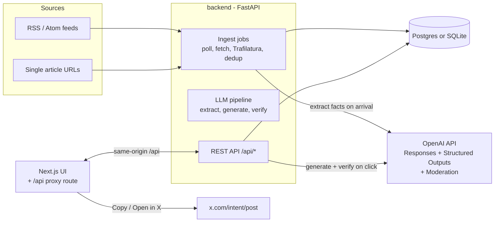

# X Post Generator

A single-user web app that turns RSS feeds and article URLs into draft X posts. Posts are written from a chosen political angle (left, center or right) and fact-checked against the source before you see them. Nothing is posted automatically: you copy the post or open it pre-filled in X and click Post yourself.

This README is the working reference for the project: what exists, how it fits together, how to run and change it, and which decisions were made and why. The product spec is the claude.ai doc "X Post Generator — v1 Spec".

---

## Contents

1. [Status](#1-status)
2. [Architecture](#2-architecture)
3. [Repository layout](#3-repository-layout)
4. [Running locally](#4-running-locally)
5. [Configuration](#5-configuration)
6. [How the pipeline works](#6-how-the-pipeline-works)
7. [Political angle rubrics](#7-political-angle-rubrics)
8. [Data model](#8-data-model)
9. [API reference](#9-api-reference)
10. [Frontend pages](#10-frontend-pages)
11. [Background jobs](#11-background-jobs)
12. [Testing](#12-testing)
13. [Deploying to Railway](#13-deploying-to-railway)
14. [Common changes](#14-common-changes)
15. [Decisions and deviations from the spec](#15-decisions-and-deviations-from-the-spec)
16. [Troubleshooting](#16-troubleshooting)
17. [Roadmap (v2 candidates)](#17-roadmap-v2-candidates)

---

## 1. Status

v1 is feature-complete against the spec, with these limits:

| Area | State |
| --- | --- |
| Backend tests (13) | Pass. They mock OpenAI and the network. |
| Real RSS ingestion + article extraction | Verified against the live BBC World feed. |
| Frontend type-check and production build | Clean. |
| End-to-end UI flow | Verified through the `/api` proxy with a stand-in for OpenAI (login, add feed, generate, fact-check flags, status page). |
| **Real OpenAI calls** | **Not yet run.** No API key was available during the build. |
| **Postgres + Redis + worker (Railway mode)** | **Written but never run.** Docker wasn't available on the dev machine. |

First things to check once a key is in place:

- The default model names (`gpt-5` and `gpt-5-mini`) are valid for your account.
- Structured Outputs parsing works with those models.
- Tune the angle rubrics on about 20 real articles (spec: "Tuning").

Product decisions recorded in the spec:

- No X Premium, so the limit is 280 characters.
- 3-point angle scale.
- The source link goes in the post itself.
- Hosted locally first, then on Railway.

---

## 2. Architecture



There are two paths:

- **Ingest (background):** feeds are polled and articles fetched, deduplicated, and turned into facts once, when they arrive.
- **Generate (on demand):** when you click Generate, the API writes 3 candidates and verifies each one in parallel.

The browser only ever talks to the Next.js server. Its catch-all route `frontend/app/api/[...path]/route.ts` proxies to the backend. That keeps the session cookie first-party and keeps the OpenAI key server-side.

---

## 3. Repository layout

```
fungameX/
├── README.md                  ← this file
├── docker-compose.yml         ← production-like stack (Postgres, Redis, backend, worker, frontend)
├── .claude/launch.json        ← dev-server configs for Claude Code's preview
├── backend/
│   ├── requirements.txt
│   ├── Dockerfile             ← used for both the backend and worker services
│   ├── .env.example           ← copy to .env
│   ├── alembic.ini
│   ├── alembic/versions/      ← migrations (0001_initial_schema.py)
│   ├── app/
│   │   ├── main.py            ← FastAPI app; runs migrations at startup; starts scheduler in thread mode
│   │   ├── worker.py          ← `python -m app.worker`: scheduler + RQ worker (Redis mode only)
│   │   ├── config.py          ← all settings (env vars), DB URL normalization, jobs mode
│   │   ├── db.py              ← engine, sessions, run_migrations()
│   │   ├── models.py          ← SQLAlchemy models + UTCDateTime type
│   │   ├── schemas.py         ← Pydantic request/response models
│   │   ├── auth.py            ← single-password login, signed session cookie
│   │   ├── jobs.py            ← enqueue() for rq/thread/sync modes; poll scheduler
│   │   ├── logging_setup.py   ← JSON logs to stdout
│   │   ├── routers/           ← sources, items, posts, misc (auth, settings, admin, health), errors
│   │   ├── services/
│   │   │   ├── ingest.py      ← feed fetch/preview/poll, article extraction, dedup, process_item
│   │   │   ├── fetch.py       ← httpx client, robots.txt cache, page fetching
│   │   │   ├── llm.py         ← OpenAI wrapper + output schemas
│   │   │   ├── pipeline.py    ← extract / generate / verify, budget, prompt & rubric loading
│   │   │   ├── charcount.py   ← X weighted character counting (mirror of frontend/lib/charcount.ts)
│   │   │   ├── urls.py        ← URL canonicalization for dedup
│   │   │   └── settings_store.py ← user defaults in the settings table
│   │   ├── prompts/           ← extract.md, generate.md, verify.md (versioned)
│   │   └── angles/            ← left.yaml, center.yaml, right.yaml (versioned rubrics)
│   └── tests/                 ← conftest.py (fakes), test_units.py, test_flow.py
└── frontend/
    ├── package.json           ← Next 14.2, React 18.3, Tailwind 3.4
    ├── Dockerfile             ← standalone Next build
    ├── middleware.ts          ← redirects to /login when there's no session cookie
    ├── app/
    │   ├── api/[...path]/route.ts ← proxy to BACKEND_URL
    │   ├── page.tsx           ← Inbox
    │   ├── items/[id]/page.tsx← Item detail + generate + review
    │   ├── sources/ history/ settings/ admin/ login/
    ├── components/            ← Nav, PostCard, ui (badges, segmented control, spinner)
    └── lib/                   ← api.ts (fetch wrapper, X intent URL), charcount.ts, types.ts
```

---

## 4. Running locally

Prerequisites are Python 3.12 and Node 20. You don't need Docker, Postgres or Redis. Without `REDIS_URL` the backend uses SQLite at `backend/data/app.db` and runs jobs on threads inside the API process.

**Backend** (first time):

```bash
cd backend
python -m venv .venv
.venv/Scripts/pip install -r requirements.txt     # macOS/Linux: .venv/bin/pip
cp .env.example .env                               # set OPENAI_API_KEY, APP_PASSWORD, SECRET_KEY
```

Run it:

```bash
cd backend
.venv/Scripts/uvicorn app.main:app --port 8000
```

**Frontend:**

```bash
cd frontend
npm install
npm run dev
```

Then:

1. Open http://localhost:3000 and sign in with `APP_PASSWORD`.
2. **Sources:** paste a feed URL, click Preview, then Add feed. Or switch to "Single URL".
3. **Inbox:** items show "Processing" until facts are extracted, then "Ready". The page refreshes itself while anything is processing.
4. Open an item, choose an angle, tone, hashtags and link setting, and click **Generate 3 posts**.
5. Edit if you want, then **Open in X** or **Copy**. Either one marks the post as used.

The frontend expects the backend at `http://127.0.0.1:8000`. Override that with `BACKEND_URL`.

Migrations run automatically when the backend starts (`run_migrations()` in `app/main.py`).

---

## 5. Configuration

All backend settings are environment variables, read by `backend/app/config.py`. Names are case-insensitive. For local work, put them in `backend/.env`.

| Variable | Default | Purpose |
| --- | --- | --- |
| `OPENAI_API_KEY` | (empty) | Required for extraction, generation and verification. Without it, items fail with "OPENAI_API_KEY is not set". |
| `OPENAI_MODEL_WRITER` | `gpt-5` | Model used to write posts. |
| `OPENAI_MODEL_FAST` | `gpt-5-mini` | Model used for extraction and verification. |
| `OPENAI_MODERATION_MODEL` | `omni-moderation-latest` | Moderation check on every candidate. |
| `OPENAI_PRICE_WRITER_INPUT` / `_OUTPUT` | `0` | USD per 1M tokens. Needed for cost tracking and the budget cap. |
| `OPENAI_PRICE_FAST_INPUT` / `_OUTPUT` | `0` | Same, for the fast model. |
| `APP_PASSWORD` | `changeme` | The single login password. **Change it.** |
| `SECRET_KEY` | `dev-secret-change-me` | Signs the session cookie. **Change it.** Changing it signs everyone out. |
| `SESSION_MAX_AGE_DAYS` | `30` | How long a login lasts. |
| `COOKIE_SECURE` | `false` | Set `true` in production (HTTPS). |
| `DATABASE_URL` | SQLite file | `postgres://` and `postgresql://` URLs are rewritten to use psycopg 3 automatically. |
| `REDIS_URL` | (empty) | If set, jobs go through RQ and need `python -m app.worker`. |
| `USER_AGENT` | `XPostGenerator/1.0 (...)` | Sent on every fetch and used for robots.txt checks. |
| `FETCH_TIMEOUT_S` | `20` | HTTP timeout for feeds and pages. |
| `SCHEDULER_TICK_S` | `60` | How often the scheduler looks for feeds that are due. |
| `ARTICLE_MAX_CHARS` | `48000` | Article text is truncated to this (about 12k tokens) before extraction. |

The frontend has two variables:

- `BACKEND_URL` is read at runtime by the proxy route.
- `PORT` is used by `npm start` and the Docker image.

User-facing defaults live in the database, not in env vars: angle, tone, include link, hashtags, character limit and monthly budget. Edit them on the **Settings** page.

---

## 6. How the pipeline works

### 6.1 Ingestion (`services/ingest.py`)

1. **Poll:** `poll_source(source_id)` fetches the feed with `If-None-Match` / `If-Modified-Since`. A 304 response only updates `last_polled_at`.
2. **robots.txt** is checked for every feed and page, cached per origin for 1 hour. An unreachable robots.txt counts as allowed.
3. **New entries:** each entry's link is canonicalized (`services/urls.py`: lowercase host, strip `www.`, the fragment, `utm_*` / `at_*` and other tracking parameters, and any trailing slash). Entries whose canonical URL already exists are skipped. New ones become `items` with `status="new"` and the feed's summary saved, and a `process_item` job is queued.
4. **Process:** `process_item(item_id)`:
   - Fetches the page and extracts the main text with Trafilatura (`favor_precision=True`).
   - If that yields fewer than 300 characters, it falls back to the feed summary when the summary is longer.
   - With no text at all, the item becomes `extract_failed` with the reason (paywall / HTTP 401/402/403, robots, timeout and so on).
5. **Dedup:**
   - Exact: same `content_hash` (SHA-256 of the normalized text).
   - Near-duplicate: same story from a *different* source within 72 hours, judged by title-token Jaccard of at least 0.75 (stopwords removed, at least 4 tokens per title).
   - A duplicate gets `duplicate_of` set. It's hidden from the inbox, shown as "+N other sources" on the original, and costs no LLM calls.
6. **Extract facts:** see below.

Single URLs create a `sources` row (`type="url"`, inactive) plus one item, then go through the same `process_item`.

### 6.2 Step 1: Extract (`pipeline.extract_facts_for_item`, fast model)

- Input: the title, URL and article text.
- Output schema (`ExtractResult`): `summary` (60 words or fewer), `claims[]` (`id`, `text`, `quote`) and `topic_tags[]`.
- **Quote validation in code:** each claim's `quote` must appear in the article after normalizing whitespace, curly quotes, dashes and case. Claims that fail are dropped and logged.
- If no claims survive, the item becomes `extract_failed`. Otherwise it becomes `extracted` (shown as "Ready").
- Runs once per item. Every generation reuses the stored `item_facts`.

### 6.3 Step 2: Generate (`pipeline.generate`, writer model)

- The budget check runs first; see 6.6.
- Options are normalized against the saved defaults:
  - `angle` ∈ left / center / right
  - `tone` ∈ neutral / punchy / wry / formal
  - `hashtags` 0–2
  - `max_chars` 100–280
  - `include_link`
- The prompt payload is JSON: the title, summary, claims, the rendered angle rubric, the tone, `max_text_chars`, `hashtags`, the number of candidates, an optional user instruction, and `avoid_repeating` (used when regenerating one post).
- **Link handling:** the model is told not to include URLs. The backend strips any URLs it adds anyway and appends `"\n\n" + canonical_url`. The text budget is `max_chars − 23 − 2` = **255** at the default 280.
- Claim ids the model invents are filtered out of `claim_ids`.
- Output schema (`GenerateResult`): `candidates[]` (`text`, `claim_ids`, `framing_note`).

### 6.4 Step 3: Verify (`pipeline.verify_text`, fast model, parallel)

Each candidate is checked against the claims, with the link stripped first.

| Check | Done by | Result |
| --- | --- | --- |
| Unsupported or misattributed factual claim | LLM (`VerifyResult.issues`) | **fail** |
| Exaggerated claim | LLM | warn |
| Over the character limit (X weighting) | code | **fail** |
| More hashtags than requested | code | warn |
| OpenAI Moderation flags it | Moderation endpoint | **fail** |
| The verify call itself errors | code | **fail** (with the error message) |

The result is stored on `posts.verification`:

```json
{"status": "pass|warn|fail", "supported": true, "issues": [{"span", "problem", "explanation"}],
 "moderation_flagged": false, "moderation_categories": [], "checks": {"char_count", "too_long", "hashtags", "hashtags_over"},
 "error": null, "prompt_version": "verify-1", "verified_at": "..."}
```

Editing a post sets `"stale": true`. The UI then shows "Edited, re-check", and **Re-check facts** re-runs verification.

### 6.5 Character counting (`services/charcount.py` and `frontend/lib/charcount.ts`)

This approximates the twitter-text v3 rules:

- Any `http(s)://…` URL counts as 23.
- Code points in 0–4351, 8192–8205, 8208–8223 and 8242–8247 count as 1.
- Everything else (CJK, emoji) counts as 2.

**The two files must stay in sync.**

### 6.6 Cost and budget

- Each OpenAI call's tokens are multiplied by the `OPENAI_PRICE_*` settings.
- Extraction cost is stored on `item_facts.cost_usd`. Generation, regeneration and verification costs add to `generations.cost_usd`.
- Monthly spend is both sums since the 1st of the month (UTC).
- If `monthly_budget_usd` > 0 and spend has reached it:
  - Generate returns HTTP 429.
  - New items' extraction fails with "Monthly budget … reached". Use **Try again** after raising the cap.
- If no prices are set, spend shows as $0 and the cap does nothing. The Status page says "Not tracked".

### 6.7 OpenAI call details (`services/llm.py`)

- Uses `client.responses.parse(model, instructions, input, text_format=PydanticModel)` and reads `output_parsed`.
- `max_retries=2`, so up to 3 attempts with exponential backoff (built into the SDK), and a 90 s timeout.
- Returns None or refusal → `LLMError("The model returned no structured output…")` → HTTP 502 in the UI.
- Moderation failures are logged and treated as not flagged.
- No `temperature` is sent, because GPT-5-family reasoning models reject it.

---

## 7. Political angle rubrics

Each angle is a YAML file in `backend/app/angles/` with these fields:

- `version`
- `label`
- `values`
- `emphasis`
- `solutions`
- `tone_guardrails`
- `example_story`
- `examples` (3 posts)

**Why a fictional story:** the examples all cover a made-up story about Riverton bus fares. The prompt says to copy the style, never the facts, so example facts can't leak into real posts.

The generation and verify prompts enforce these rules for every angle:

- Use only the provided claims as facts.
- Never exaggerate numbers or change who said or did what.
- Opinion must read as opinion.
- No slurs, dehumanizing language or harassment of private individuals.
- No long verbatim passages.

**To tune an angle:** edit its YAML and **bump `version`** (for example `left-2`). Each generation stores `rubric_version` and `prompt_version`, so you can compare outputs before and after in the database. Restart the backend afterwards; rubrics and prompts are cached in memory.

---

## 8. Data model

The schema is created by `alembic/versions/0001_initial_schema.py`. JSON columns use `JSONB` on Postgres and `JSON` on SQLite. Every datetime column uses `UTCDateTime`, which always returns timezone-aware UTC, because SQLite would otherwise drop the timezone.

| Table | Key columns | Notes |
| --- | --- | --- |
| `sources` | `type` (`rss`/`url`), `url`, `title`, `tags` (json list), `active`, `poll_interval_min` (10–1440), `etag`, `last_modified`, `last_polled_at`, `last_error` | Deleting a source cascades to its items, facts, generations and posts. |
| `items` | `source_id`, `canonical_url`, `title`, `author`, `published_at`, `feed_summary`, `raw_text`, `content_hash`, `status` (`new`/`extracted`/`extract_failed`/`dismissed`), `error`, `duplicate_of` | The UI labels `new` as "Processing" and `extracted` as "Ready". |
| `item_facts` | `item_id`, `summary`, `claims` (json), `topic_tags`, `model`, `prompt_version`, `cost_usd` | Latest row per item = `item.latest_facts`. |
| `generations` | `item_id`, `facts_id`, `angle`, `tone`, `options` (json), `instruction`, `model`, `prompt_version`, `rubric_version`, `cost_usd` | One per Generate / Regenerate-all click. |
| `posts` | `generation_id`, `text`, `original_text`, `char_count`, `claim_ids`, `framing_note`, `verification` (json), `status` (`candidate`/`edited`/`used`/`discarded`), `used_at` | `original_text` makes it possible to measure how much a post was edited (spec metric). |
| `settings` | `key`, `value` (json) | Keys: `angle`, `tone`, `include_link`, `hashtags`, `max_chars`, `monthly_budget_usd`. |

---

## 9. API reference

All routes are under `/api`. Everything except `health` and `auth/login|logout` needs the `xpg_session` cookie. Errors come back as `{"detail": "..."}`.

**Auth and misc** (`routers/misc.py`)

| Method | Path | Notes |
| --- | --- | --- |
| GET | `/health` | `{"ok": true}` |
| POST | `/auth/login` | `{password}` → sets the cookie. 401 on a wrong password. |
| POST | `/auth/logout` | Clears the cookie. |
| GET | `/auth/me` | 401 if not signed in. |
| GET / PUT | `/settings` | Defaults. PUT accepts any subset. |
| GET | `/admin/status` | Key set?, models, jobs mode, month spend, budget, feed errors, failed items, recent generations. |

**Sources** (`routers/sources.py`)

| Method | Path | Notes |
| --- | --- | --- |
| GET | `/sources?type=rss\|url` | Includes `item_count` (duplicates excluded). |
| POST | `/sources/preview` | `{url}` → `{title, entries[3]}`. 400 if it isn't a valid feed. |
| POST | `/sources` | `{type, url, title?, tags?, poll_interval_min?}`. RSS: queues an immediate poll; 409 if the feed already exists. URL: creates an item and queues processing; 409 if the article already exists. |
| PATCH | `/sources/{id}` | `title`, `tags`, `active`, `poll_interval_min` |
| DELETE | `/sources/{id}` | Cascades. |
| POST | `/sources/{id}/refresh` | Queues a poll now (RSS only). |

**Items and generation** (`routers/items.py`)

| Method | Path | Notes |
| --- | --- | --- |
| GET | `/items?status=&source_id=&q=&limit=&offset=` | Leaves out duplicates. Leaves out dismissed items unless `status=dismissed`. Newest first. |
| GET | `/items/{id}` | Facts, generations with posts (newest first), duplicates, raw text. |
| POST | `/items/{id}/dismiss`, `/items/{id}/restore` | |
| POST | `/items/{id}/retry` | Re-fetches and re-extracts (after a failure, a missing key, or the budget cap). |
| POST | `/items/{id}/generate` | `{angle?, tone?, include_link?, hashtags?, max_chars?, instruction?}` → generation with 3 verified posts. 400 if the item has no facts, 429 over budget, 502 on an OpenAI failure. |
| POST | `/generations/{id}/regenerate` | `{instruction?}` → a new generation with the same options. Unused posts in the old one are discarded. |

**Posts** (`routers/posts.py`)

| Method | Path | Notes |
| --- | --- | --- |
| GET | `/posts?source_id=&angle=&status=&date_from=&date_to=` | History. With no status it shows `used` + `edited`. |
| PATCH | `/posts/{id}` | `{text}` → status `edited`; verification marked stale. |
| POST | `/posts/{id}/verify` | Re-runs verification on the current text. |
| POST | `/posts/{id}/regenerate` | `{instruction?}` → a new post in the same generation; the old one is discarded. |
| POST | `/posts/{id}/use` | Sets `used` + `used_at`. The UI calls this on Copy or Open in X. |
| POST | `/posts/{id}/discard` | |

FastAPI's interactive docs are at http://localhost:8000/docs while the backend runs.

---

## 10. Frontend pages

| Route | What it does |
| --- | --- |
| `/login` | Password form. Redirects back to `?next=` afterwards. |
| `/` (Inbox) | Paste-a-URL box, status filter chips, source filter, title search. Items show a status badge, summary and duplicate count, with Write posts / Dismiss buttons. Polls every 5 s while anything is processing. |
| `/items/[id]` | Summary, numbered claims with their quotes, "also covered by", and the extracted text (toggle). Generate panel: angle segmented control, tone, hashtags, include link, instruction. Below that, generations newest first, each with **PostCard**s and Regenerate all. |
| `/sources` | Add a feed (Preview, then Add with a check interval and tags) or a single URL. Feed list with refresh, pause/resume, rename, tags, delete, last error. One-off URLs are collapsed. |
| `/history` | Filters for status, angle, source and date range. Copy and Open in X per post. |
| `/settings` | Defaults and monthly budget. |
| `/admin` (nav label "Status") | Setup check, spend vs budget, feed errors, failed items, recent generations. |

**PostCard** (`components/PostCard.tsx`) shows:

- A verification badge and a status badge.
- An editable textarea with a live weighted character count.
- The flagged phrases highlighted in the text: red for not in source or misattributed, amber for exaggerated.
- The list of issues and which claims the post uses (hover for the claim text).
- Buttons: Open in X, Copy, Save edit, Re-check facts, Regenerate (with an optional instruction) and Discard.

Failed candidates are tinted and greyed. Open in X opens the window *before* any await, so popup blockers allow it.

The X intent URL is `https://x.com/intent/post?text=<encoded>` (built in `lib/api.ts`).

---

## 11. Background jobs

`app/jobs.py` picks a mode:

| Mode | When | Behavior |
| --- | --- | --- |
| `thread` | No `REDIS_URL` (local dev) | Jobs run on a 4-thread pool in the API process. The API also starts the scheduler thread. |
| `rq` | `REDIS_URL` set (Railway) | Jobs go to the RQ `default` queue. `python -m app.worker` runs the scheduler thread plus an RQ worker. RQ doesn't run on Windows; use this mode on Linux only. |
| `sync` | `JOBS_MODE_OVERRIDE=sync` (tests) | Jobs run inline. |

Every `SCHEDULER_TICK_S` seconds, the scheduler queues `poll_source` for each active RSS source whose `last_polled_at` is older than its interval (minimum 10 minutes). In thread mode, polling only happens while the API is running.

---

## 12. Testing

```bash
cd backend
.venv/Scripts/python -m pytest -q
```

How the tests are set up:

- `tests/conftest.py` sets a temporary SQLite DB, sync jobs and a test password *before* importing the app.
- It swaps in fakes for `pipeline.call_structured`, `pipeline.moderate`, `ingest.fetch_feed` and `ingest.extract_article`.
- The fake generator always produces one candidate containing an unsupported "99%" claim, so the tests can confirm verification flags it.
- Migrations run for real in the tests, through the app's startup.

What's covered:

- **Units:** character counting, hashtags, URL canonicalization, quote validation, title similarity, prompt and rubric loading.
- **Flow:** login required, add feed → items → facts (an invalid quote is dropped), no duplicates on re-poll, generate → 3 posts with the link appended and the right counts, the planted claim fails, edit / re-verify / use, regenerate one, history filters, cross-source duplicate, budget cap returns 429, settings.

Frontend: `cd frontend && npx tsc --noEmit && npm run build`.

**To exercise the UI without an OpenAI key**, write a small launcher that sets `DATABASE_URL` to a scratch file, replaces `app.services.pipeline.call_structured` and `.moderate` with fakes (same idea as `conftest.py`), and runs `uvicorn.run(app, port=8000)`. Then start the frontend as usual.

---

## 13. Deploying to Railway

Create one Railway project with five services:

| Service | Source | Configuration |
| --- | --- | --- |
| **Postgres** | Railway Postgres | none |
| **Redis** | Railway Redis | none |
| **backend** | this repo, root directory `backend` (uses `backend/Dockerfile`) | `DATABASE_URL=${{Postgres.DATABASE_URL}}`, `REDIS_URL=${{Redis.REDIS_URL}}`, `PORT=8000`, `OPENAI_API_KEY`, `APP_PASSWORD`, `SECRET_KEY`, `COOKIE_SECURE=true`, `OPENAI_PRICE_*` (optional), model overrides (optional). No public domain. |
| **worker** | same repo, root directory `backend` | Same variables as backend. Start command: `python -m app.worker` |
| **frontend** | same repo, root directory `frontend` (uses `frontend/Dockerfile`) | `BACKEND_URL=http://${{backend.RAILWAY_PRIVATE_DOMAIN}}:8000`. Generate a public domain. |

Notes:

- The backend binds to `::` (IPv6 and IPv4) because Railway's private network uses IPv6.
- Both the backend and worker run `alembic upgrade head` at startup. That's safe: Alembic skips migrations that are already applied.
- The frontend image uses Next's `standalone` output and reads `BACKEND_URL` at runtime, so changing it needs no rebuild.
- `docker-compose.yml` mirrors this setup if you want to try it locally with Docker (`docker compose up --build`, after creating `backend/.env`).

---

## 14. Common changes

**Change models:** set `OPENAI_MODEL_WRITER` / `OPENAI_MODEL_FAST`. The model must support the Responses API with Structured Outputs. Schemas use only required fields, lists and `Literal`, to stay within strict-mode limits.

**Edit a prompt:** edit `backend/app/prompts/<name>.md`, bump `version:` in its front matter, and restart.

**Add a tone:** add it to `TONES` in `services/pipeline.py`, the `Tone` literal in `schemas.py`, `Tone` in `frontend/lib/types.ts`, and the tone lists on the item and settings pages.

**Add an angle (for example a 5-point scale):**
1. Add `backend/app/angles/<name>.yaml`.
2. Extend `ANGLES` in `pipeline.py` and `Angle` in `schemas.py`.
3. Widen `generations.angle` if the name is over 10 characters (needs a migration).
4. Update `frontend/lib/types.ts`, `ANGLES` in the item page, the settings page, `AngleBadge` and the history filter.

**Add a database column:**
1. Edit `models.py`.
2. Generate a migration: `.venv/Scripts/alembic revision --autogenerate -m "describe change"`, with `DATABASE_URL` pointing at a database that's at the current head.
3. Review the generated file. Autogenerate writes `astext_type=Text()` without the `sa.` prefix, which breaks the migration.

**Add a source type (video, podcast, PDF):**
1. Add a `type` value.
2. Write an adapter that produces `raw_text` for an item (for example a transcript).
3. Reuse `process_item`'s dedup and extraction path.

The pipeline doesn't care where text comes from.

**Change the link format:** `LINK_SEPARATOR` and `_finalize_text` in `pipeline.py`. Keep `_text_budget` consistent with them.

---

## 15. Decisions and deviations from the spec

| Decision | Why |
| --- | --- |
| SQLite and in-process jobs when `REDIS_URL` is unset | The dev machine had no Docker, Postgres or Redis. This lets the app run with two commands. Production still uses Postgres + RQ as specified. |
| Migrations run on startup | One less manual step locally and on Railway. |
| `item_facts.cost_usd` added (not in the spec's data model) | Extraction is an LLM cost too; the budget needs it. |
| `posts.original_text` and `framing_note` added | To measure edit distance (a spec metric) and to show the angle taken. |
| Extraction also stops at the budget cap | The spec only said "blocks generation", but extraction on arrival would otherwise keep spending. |
| Duplicates skip extraction entirely | Saves cost. The original item carries the story. |
| Over budget returns HTTP 429; OpenAI failure returns 502 | The UI shows `detail` as-is. |
| Model names via env, defaults `gpt-5` / `gpt-5-mini` | The spec deliberately left models configurable. **Check these defaults when the key is added.** |
| Angle examples use a fictional story | Prevents example facts from leaking into real posts. |
| Single-password auth with an itsdangerous-signed cookie | The spec allowed "password or magic link". Password is simplest for one user. |
| Next.js route-handler proxy instead of `rewrites` | Reads `BACKEND_URL` at runtime (Railway), forwards `Set-Cookie`, keeps one origin. |

---

## 16. Troubleshooting

| Symptom | Likely cause / fix |
| --- | --- |
| Items stuck on "Processing" | Locally, the API process must be running (jobs run inside it). On Railway, check the worker service logs. |
| Item "Failed: OPENAI_API_KEY is not set" | Set the key, restart the backend, click **Try again** on the item. |
| Item "Failed: access denied (HTTP 403), possibly a paywall" | The site blocks fetching. Feeds with a full-text summary still work through the fallback. Otherwise use a different source. |
| Item "Failed: blocked by robots.txt" | That's intended. The site disallows the user agent. |
| "no claims could be verified against the article text" | The model's quotes didn't match the text exactly. Usually caused by odd extraction; retry, or check the extracted text on the item page. |
| Generate returns 502 | OpenAI error, an invalid model name, or a refusal. The message includes the SDK error. Check the backend logs (JSON, `logger: app.llm`). |
| Generate returns 429 | The monthly budget was reached. Raise it in Settings. |
| UI says "Backend is unreachable" | The frontend can't reach `BACKEND_URL`. Check the backend is up and the URL and port are right. |
| Always redirected to /login | The cookie was rejected. Check `SECRET_KEY` didn't change. In production, `COOKIE_SECURE=true` needs HTTPS. |
| Times look off | They shouldn't since the `UTCDateTime` fix. The API returns ISO strings ending in `Z`. |
| `pip install` breaks on `lxml.html.clean` | `lxml_html_clean` is in `requirements.txt` for exactly this reason. Reinstall the requirements. |

Logs: the backend writes JSON lines to stdout (loggers `app.ingest`, `app.llm`, `app.pipeline`, `app.jobs`). Each LLM call logs its step, model, tokens, cost and latency.

---

## 17. Roadmap (v2 candidates)

From the spec, roughly in order of value:

- YouTube and podcast sources, using transcripts or OpenAI speech-to-text.
- Threads (multi-post).
- Posting and scheduling through the X API (paid tier; check current pricing).
- A 5- or 7-point angle scale.
- Several X accounts. Watch X's rules against coordinated inauthentic behavior.
- Engagement analytics for posts marked used.

Smaller follow-ups noticed during the build:

- Add a fake-LLM dev mode behind an env flag, so the UI can be demoed without a key.
- Add frontend tests (for example Playwright) for the review flow.
- Sentence-level trimming of noise like BBC's "Published" line before extraction.
- Pagination in the inbox and history (the API supports `limit`/`offset`; the UI loads the first page only).
